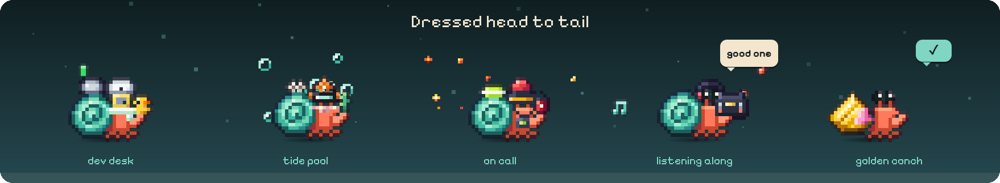
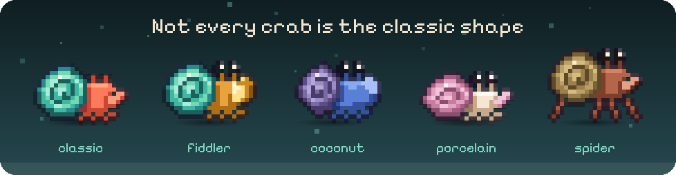
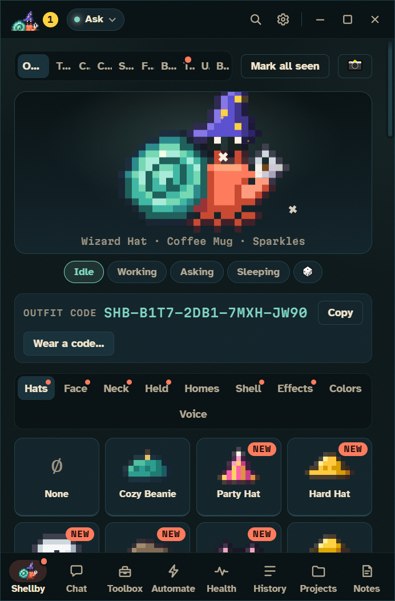
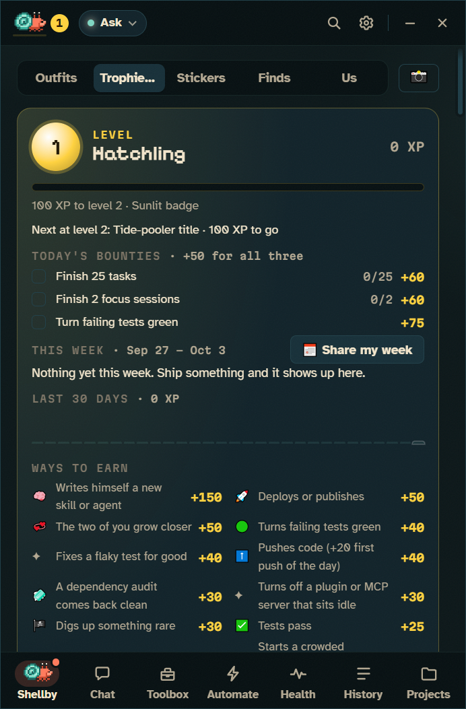
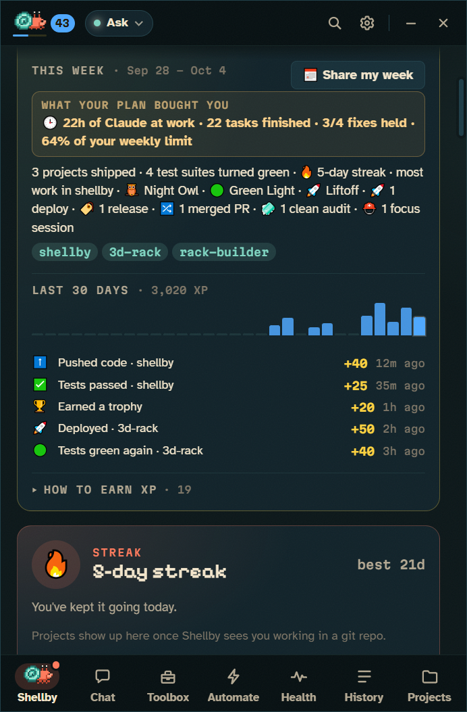
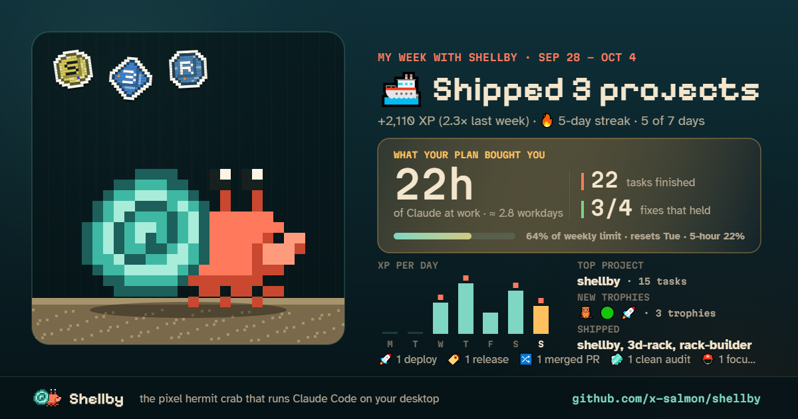
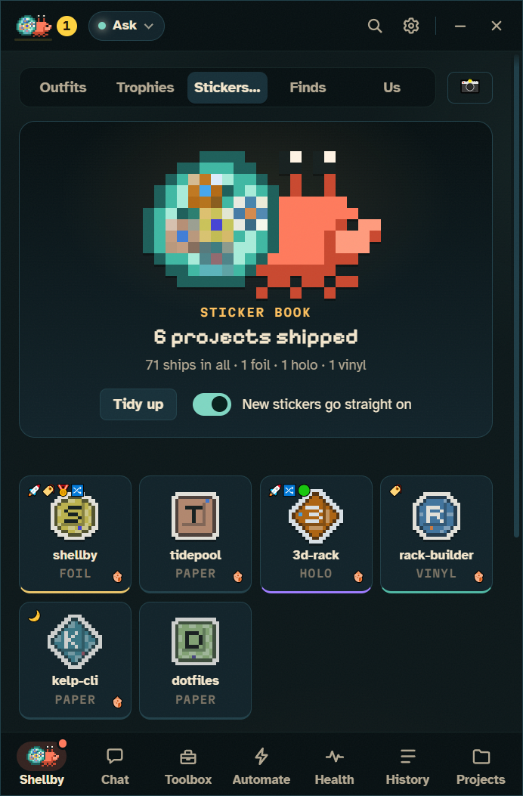
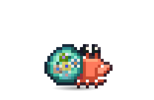
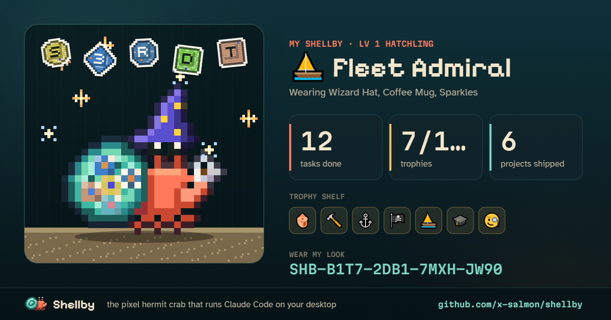
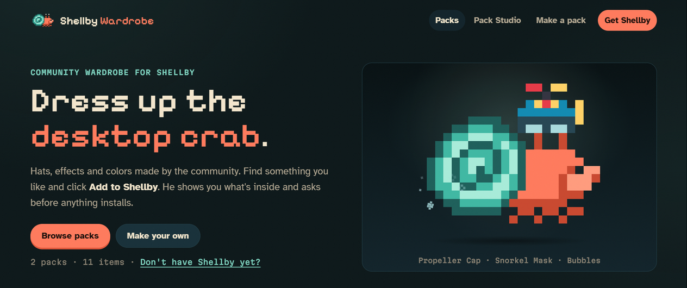

# Dressing him up

Outfits, shells, trophies, XP, stickers and the cards you can share. Back to the [README](../README.md).

## Outfits

- **173 accessories, 24 effects and 18 crabs** for his hat, face, neck, claw and shell. They move with him: a pumpkin swings with his claw, and eyewear scans along while he reads. He and everything he wears are shaded, with a fine dark line round them, so he stands out on any wallpaper.
- **Effects move like he does,** a pixel at a time: bats flap their wings, sparkles twinkle from a dot to a star and back, fireflies glow and fade, embers cool from yellow to red, leaves flip as they fall, and snow lands at his feet and blinks away.
- **Head-to-tail sets:** a dev desk with a rubber duck, a tide pool he'd actually come from, and an on-call kit with a pager and an extinguisher. Each covers every slot.
- **He grows into new shells:** level 3 brings a Snail Shell, then a Tin Can, a Teacup, a Toy Brick, the Golden Conch at level 20, and on up through a Coconut Half, a Lantern Jar, a Diving Helmet, a Crystal Geode and a Treasure Chest to the Rainbow Nautilus at level 99. Each is a little molt on your desktop: out of the old shell, a shiver, into the new one. Pick any home you've grown into under **Outfits → Homes**.
- **Seasons:** he dresses up for Halloween, winter, Valentine's, spring, summer and autumn, and seasonal items are yours to keep if you're around while the season is on.
- **Helper crabs wear matching hats,** and every crab in the app is dressed the same way.
- **Outfit codes** like `SHB-B1T7-2DB1-7MXH-JW90` share a look: paste someone's code into **Wear a code…** and Shellby previews it on your crab, then puts it on. Locked items show which trophy unlocks them, and items from packs you don't have come with a **Get pack** button. Codes are typo-proof and need no server.

<table>
<tr>
<td width="50%"></td>
<td width="50%"></td>
</tr>
</table>

## Trophies and XP

- **102 trophies**, a few of them secret, unlock outfits as you use him: the rubber duck arrives when you let him run a script he wrote, the barnacles after seven days together. Finish 10 tasks for a hard hat, send out your first helper for a captain's hat, finish a task after midnight for a nightcap, free up a full drive for a broom. Most trophies hand out one to three things, and unlocks celebrate on your desktop with confetti.
- **XP and levels,** from Hatchling to Shellby Supreme at level 99, with a new title, badge colour or shell at least every five levels. Past 99 the XP keeps counting in marks: ★1 at 5,000 XP more, and each one after costs 500 more than the last. The badge shows them (99★3), and each one gets a celebration.
- **XP sources:** a new skill or agent he writes for himself (+150, usually a level-up), deploys (+50), turning failing tests green (+40), pushes (+40, and +20 for the first push of the day to a project), a clean dependency audit (+30, once a day per project), trophies (+20), passing tests (+15), focus sessions (+15) and finished tasks (+5). Petting, games, finds and growing closer earn XP too, so a crab-only Shellby levels up as well. It counts in Shellby and, with the plugin, in your terminal too. "+25 XP" floats up from him on the desktop. Doing the same thing over and over within an hour pays half, then a quarter, then nothing, so a test loop can't farm it.
- **Bonuses:** a streak adds 5% for each week in it with three or more worked days (up to +25%), and coming back after three days or more away doubles your next 150 XP.
- **Streaks never punish** (`src/main/progression/streaks.js`). Saturday and Sunday are rest days by default: they hold the streak without counting toward it. Turn that off with **🏖️ weekends off** on the XP card; the change counts from today, so past weekends stay held. One missed working day a week is a 🌊 **tide-out**: the streak holds, and he says so. If it does break, the bonus slides 5% per missed working day instead of vanishing, and a new streak keeps that floor until it catches up.

## Levels 20 to 99

Almost every level from 20 to 99 unlocks something (`src/main/progression/levels.js`, the whole table in `docs/GAMIFICATION-PLAN.md` section 2.3): a title or rank badge, one of 12 more shells (`src/main/progression/shells-extra.js`), one of 27 tank decor pieces or 19 effects (`src/wardrobe/depths.json`, gated `unlock: { level }`), a perk, a bigger tank or a quest chapter. A thin bar under the XP bar counts down to the next one ("Next: 🐚 Ammonite at Lv 32, 1,240 XP to go"); hover it for everything at that level, or open **Every level** for the whole ladder and the perks.

- **Perks** are quality of life and looks only: a bigger rested pool (22), a bounty reroll (28), a fourth bounty (33), battle replays (38), two tide-outs a week (44), the reef forecast (52), golden jars (58), crew colours (66), foil cards (77) and a Wrapped deep-cuts slide (88).
- **Milestones:** levels 20, 30, 40, 60, 70, 80 and 90 get a full-panel ceremony in the new rank's colour (the title writes itself, the unlock cards flip in); 50 and 99 are legendary, with a card to share and a journal entry. With reduced motion it's a still card.
- Every gate reads **everLevel**, the highest level ever reached, so nothing is ever taken back.

## Molting

At 99 he can **Molt** (`src/main/progression/molting.js`), never has to: staying at 99 keeps earning ★ marks. A molt starts the level number again at 1 and keeps everything: XP, titles, badges, shells, decor, effects, perks, the Bugdex, tank, trophies, stickers, quests and streak. The climb back is 80% as long the first time, 90% the second, then slowly steeper (at most double). Each molt earns a **tier shell** and a ring round his level badge (I to XII, then numbers). Molts sync between PCs with the XP.

The first twelve tier shells are hand-made (`src/main/progression/shells-molt.js`): Ember Conch, Glacier Geode, Circuit Nautilus, Nebula Whorl, Kraken's Eye, Lava Lamp, Bone Cathedral, Prism Shard, Void Pearl, Clockwork Ammonite, Aurora Spire and Leviathan Crown. Past twelve, `src/main/progression/shell-gen.js` makes one from the molt number: a hand-made silhouette, one of six patterns, a golden-angle palette and a name like "Howling Volute", the same on every PC. Wear any tier shell you've earned from the Molt sheet or Outfits → Homes.

### Making a shell

1. Copy a 13 × 12 grid from `src/main/progression/shells.js` (or `shells-extra.js`). `.` is empty; every other character is a single-letter key in `palette` (`#rrggbb`).
2. Stay in the shell space: the cells every skin leaves to the shell or empty. Only the bottom-right corner (column 12 from row 9, column 11 in row 10) is off limits.
3. Light it from the top left: highlights there, the darkest shade on the right and bottom edges.
4. Optional effects, drawn by `src/renderer/shared/sprite.js`: `frames` (1 to 3 more grids of the same size) with `fps` 1 to 8; `cycle: { keys, fps }` passes those keys' colours round (lava flowing, a ring spinning); `aura: '#hex'` for a glow; `sparkle: 0-6` twinkling pixels. With reduced motion only the first picture is drawn.
5. `node --test test/shells.test.js` checks the mask, every frame and the palette. Preview it with `node scripts/crab-sheet.js`.
6. A level shell also needs a 10 × 10 gutter mark in `src/renderer/shared/minishell.js` (`test/minishell.test.js` checks).
- **Daily bounties:** three small goals a day ("Push to 2 different projects", "Turn failing tests green"), the same three on every PC. Each pays XP, and clearing all three pays 50 more.
- **Trophies & XP:** click the level badge next to him in the title bar to see his level, what the next level unlocks, today's bounties, XP for the last 30 days and by kind, the XP log and a 🔥 badge with your streak. The badge changes colour every ten levels. Click the 🔥 to see the streak itself, project by project, on **Time**, next to **Guard my focus**.
- **Across PCs:** with GitHub sync on, XP earned on each PC adds up.

## Character sheet

Trophies & XP also has his **character sheet**: four RPG-style stats worked out from the XP he already keeps, nothing new to track.

| Stat | Grows with |
|---|---|
| ⬆️ **Shipping** | pushes, deploys, and issues taken all the way to a pull request |
| ✅ **Rigour** | passing test runs, failing tests turned green, flaky tests fixed, clean dependency audits |
| 🧠 **Craft** | skills, agents and mods he writes for himself |
| 🧹 **Tidiness** | Lean Shell: idle plugins and MCP servers turned off, crowded conversations started fresh |

A stat grows with the square root of its XP, so quadrupling the XP doubles the stat (99 at most). Each stat is scaled so that a rare thing, like writing a trick, counts about as much as a common one, like a test run. A small green **+3** beside a stat is what the last seven days added.

His **class** comes from his highest stat: 🚢 **Shipper**, 🧪 **Tester**, 🛠️ **Toolsmith** or 🧹 **Curator**. When the runner-up is close behind, the two make a dual class (🏁 Release Engineer, 💡 Inventor, ⚡ Streamliner, ⚙️ Artificer, 🔍 Auditor, 📐 Architect). When all four are close he's a 🦀 **Polymath**. Until one stat reaches 5 he's a 🐚 **Wanderer**. He celebrates the first time he becomes each class, and the sheet lists the classes he has been before. If this week looks different from all time, the sheet says so ("played as a Shipper this week"). Every stat comes from Claude Code work, so the sheet is hidden in just-the-crab mode. The stats are counted on each PC separately and aren't synced.

## Your week

- **Trophies & XP → This week** sums up the last seven days: tasks done, your streak, your top project (the repo with the most finished tasks), new trophies, projects shipped, tests turned green, flaky tests fixed, deploys, releases and clean audits.
- **The week's work** sits alongside, counted as it happens and only when it did: routines (and held messages) that ran while you were away and how long Claude worked on them ("Routines worked 3h 10m while you were away"), pull requests opened and merged, builds fixed (a pull request's checks back to green and staying there), branches brought home, and turns taken back with Rewind. It's what ran, not a guess at hours saved. The card has room for the best of these on one line; the Trophies page lists them all.
- **📅 Share my week** makes a weekly crab card, with the week's stickers on his tank, his character sheet as a nameplate under his feet (his class, his four stats and what the week added to each) and XP for each day. Every Friday afternoon after a week with something done in it, Shellby hands you the card, ready to share. Projects you keep off your calling card stay off it.

## Shell stickers

 

- **A sticker for every project you ship:** the first time you push, deploy or release a repo (or a pull request of yours is merged), he holds up a sticker drawn for it and slaps it on his shell.
- **Drawn from the repo itself:** a shape, a pattern and its first letter, in the colour of the language it's mostly written in, so the same repo gets the same sticker on every PC. Shipping counts from Shellby's tabs, from Claude Code in your terminal (with the plugin), and from pull requests merged on GitHub (with CI on).
- **It gets shinier as you keep shipping:** paper, then **vinyl** at 5 ships, **holo** at 15, **foil** at 40. Deploys and releases count double, and a burst of pushes counts once an hour. Leave a project alone for two months and its sticker starts to peel at the corner; the next ship presses it back down. Releases, deploys and merges add little marks (🚀 Live, 🥇 One-point-oh, 🔀 Merged), a clean dependency audit adds 🧼 Fresh, and there are a couple of secret ones.
- **The Sticker Book** (Shellby's screen → **Stickers**) has a page for every project: when it first shipped, how often, its marks, and **Pick up where we left off**. Click a sticker and a spot on his shell to move it (or drag it there), and stack them like a laptop lid. On a spot, <kbd>[</kbd> and <kbd>]</kbd> change which is on top, <kbd>F</kbd> flips one and <kbd>Delete</kbd> peels it off. Projects you've worked in but not shipped wait there as question marks.
- **Every shell keeps its own stickers.** When he outgrows a shell, his three most-shipped stickers come with him and the rest stay on the old one, so you can move back in any time. A repo can ship its own official sticker as [`.shellby/sticker.json`](ADDONS.md#repo-stickers).
- **Friends can see them too.** With Visiting crabs on, a friend's crab arrives wearing its stickers. Nothing about yours goes on your public calling card until you choose, in the Sticker Book: **His shell** shares the stickers on his shell as patches of colour (no names or letters), and **Shell and names** adds your three most-shipped, so a friend's visit can leave you one of theirs as a swap.

## The crab card

**📸 Share** on Shellby's screen makes a card with Shellby as he's dressed, your best trophy, task count and trophy shelf. It's copied to your clipboard and saved to `Pictures\Shellby`. Sharing one earns a trophy too.

## Community wardrobe

More hats, effects, colors and voices from other people at **[getshellby.com/community](https://getshellby.com/community/)**.

- **Install in one click:** every item is previewed on a live Shellby, and the app shows exactly what a pack contains before it installs.
- **New voices:** packs can teach him to talk like a pirate, grumble like a grump, or speak another language, with little scenes to match. He ships with eight to try under **Outfits → Voice**.
- **Safe by design:** packs are pixel art, short lines and settings in JSON, so they can't run code, and each download is checked against the gallery's SHA-256.
- **Make your own** in [Pack Studio](https://getshellby.com/community/studio/), then publish it from the app (Shellby forks the gallery and opens the pull request) or by hand on [x-salmon/shellby-packs](https://github.com/x-salmon/shellby-packs). The format is in [ADDONS.md](ADDONS.md) ([JSON Schema](addon.schema.json)).
